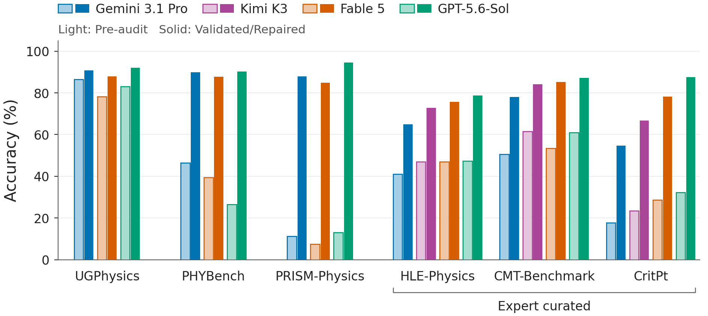
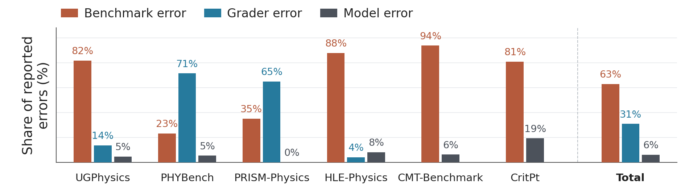

<p align="center">
  
</p>

<h1 align="center">How Good Are Frontier Models at Physics?</h1>

<p align="center">
  <strong>Expert Re-Grading Reveals Broken Evaluations and<br>Near-Saturation of Leading Benchmarks</strong>
</p>

<p align="center">
  Ali Ansari · Haoran Sun · Andy Zeyi Liu · Mark Jabbour · <a href="#citation">and 47 coauthors</a>
</p>

<p align="center">
  <a href="https://arxiv.org/abs/2609.13009"></a>
  <a href="https://arxiv.org/pdf/2609.13009"></a>
  <a href="#datasets-and-expert-audits"></a>
  <a href="#quick-start"></a>
</p>

<p align="center">
  <a href="#main-results">Results</a> ·
  <a href="#what-the-experts-found">Expert audits</a> ·
  <a href="#datasets-and-expert-audits">Datasets</a> ·
  <a href="#quick-start">Run evaluations</a> ·
  <a href="#citation">Citation</a>
</p>

Code, frozen datasets, and expert audit records for
[our paper](https://arxiv.org/abs/2609.13009). We revisit six physics benchmarks
with faculty and graduate researchers, separating genuine model mistakes from
grader errors and flawed benchmark materials. Expert correction substantially
raises measured performance on the retained, closed-ended evaluation sets.

## Main results



**Figure 1.** Light bars show pre-audit scores; solid bars show performance after
expert validation and repair. Kimi K3 is evaluated on the three expert-authored
benchmarks.

GPT-5.6-Sol's measured `mean@4` rises from **47.28% to 78.66%** on HLE-Physics
and from **61.00% to 87.24%** on CMT-Benchmark. On the paper's 54 retained CritPt
challenges, it reaches **87.50% `mean@4`** and **94.44% `pass@4`**.

Values below are percentages, **pre-audit → validated/repaired**.

| Benchmark | Fable 5 | GPT-5.6-Sol | Gemini 3.1 Pro |
|---|---:|---:|---:|
| PHYBench | 39.50 → 87.64 | 26.50 → 90.23 | 46.50 → 89.94 |
| PRISM-Physics | 7.50 → 84.80 | 13.00 → 94.59 | 11.25 → 87.84 |
| UGPhysics | 78.25 → 87.80 | 83.00 → 92.07 | 86.50 → 90.85 |
| HLE-Physics | 47.03 → 75.65 | 47.28 → 78.66 | 40.97 → 64.87 |
| CMT-Benchmark | 53.50 → 85.20 | 61.00 → 87.24 | 50.50 → 78.06 |
| CritPt† | 28.57 → 78.24 | 32.29 → 87.50 | 17.71 → 54.63 |

† CritPt uses external Artificial Analysis **`mean@5` on 70 challenges** before
the audit and **`mean@4` on 54 retained challenges** afterward. Other rows use
`mean@4` throughout. The question sets can change after expert review, so these
are comparisons across the original and retained/repaired evaluation sets.

<details>
<summary><strong>Frontier models: pass@4</strong></summary>

| Benchmark | Fable 5 | GPT-5.6-Sol | Gemini 3.1 Pro |
|---|---:|---:|---:|
| PHYBench | 47.00 → 91.95 | 34.00 → 95.40 | 50.00 → 94.25 |
| PRISM-Physics | 20.00 → 90.54 | 24.00 → 95.95 | 24.00 → 94.59 |
| UGPhysics | 82.00 → 92.68 | 85.00 → 93.90 | 88.00 → 93.90 |
| HLE-Physics | 53.47 → 83.62 | 55.94 → 91.38 | 48.51 → 74.14 |
| CMT-Benchmark | 60.00 → 93.88 | 72.00 → 97.96 | 58.00 → 87.76 |
| CritPt | — → 90.74 | — → 94.44 | — → 68.52 |

`pass@4` is the percentage of questions solved in at least one of four attempts.
Pre-audit CritPt `pass@4` is unavailable for all models.

</details>

<details>
<summary><strong>Open models: mean@4 and pass@4</strong></summary>

**Mean accuracy (`mean@4`, except pre-audit CritPt†)**

| Benchmark | Kimi K3 | GLM-5.3-Flash | Qwen3.8-27B |
|---|---:|---:|---:|
| HLE-Physics | 47.03 → 72.84 | 31.81 → 51.08 | 24.26 → 38.79 |
| CMT-Benchmark | 61.50 → 84.18 | 45.00 → 60.71 | 27.50 → 54.59 |
| CritPt† | 23.43 → 66.67 | 15.43 → 40.28 | 5.43 → 28.24 |

**Solved at least once (`pass@4`)**

| Benchmark | Kimi K3 | GLM-5.3-Flash | Qwen3.8-27B |
|---|---:|---:|---:|
| HLE-Physics | 55.45 → 82.76 | 51.49 → 78.45 | 39.11 → 60.34 |
| CMT-Benchmark | 80.00 → 93.88 | 66.00 → 77.55 | 44.00 → 73.47 |
| CritPt | — → 81.48 | — → 62.96 | — → 44.44 |

Kimi K3 and GLM-5.3-Flash use tools; Qwen3.8-27B uses no tools at `xhigh`
reasoning effort. The same CritPt scope and metric qualification applies.

</details>

## What the experts found

In the four pooled audit sets, **238 of 250 apparent failures (95.2%)** were
attributed to benchmark or grader errors. The remaining 12 were model errors.
CMT-Benchmark and CritPt were reviewed separately.



**Figure 2.** Each group is normalized by its **available reported error counts**.
Grader-error counts are unavailable for CMT-Benchmark and CritPt; they are not
assumed to be zero. The Total group pools available counts across all six
benchmarks and uses a different denominator from the four-benchmark statistic
above.

| Attribution | What went wrong |
|---|---|
| **Benchmark error** | The question or reference has a defect, such as ambiguity, a missing assumption, or an incorrect answer. |
| **Grader error** | A correct response is rejected, often because the grader fails to recognize an equivalent mathematical expression. |
| **Model error** | The question is well posed and its reference is correct, but the model's answer is wrong. |

See the [expert audit records](audit/README.md),
[CMT review notes](audit/cmt.json), and
[CritPt solution index](audit/critpt/README.md) for labels and repair evidence.

## Datasets and expert audits

The release contains frozen question/reference inputs, audit labels, and
expert-verified corrections. **Raw model generations are not included.**

| Benchmark | Locally gradeable pre-audit questions | Released post-audit questions |
|---|---:|---:|
| PHYBench | 100 | 87 |
| PRISM-Physics | 100 | 74 |
| UGPhysics | 100 | 82 |
| HLE-Physics | 202 | 116 |
| CMT-Benchmark | 50 | 49 |
| CritPt | 54 | 54 |

PHYBench uses the 100 questions with public references; PRISM and UGPhysics
use frozen 100-question text-only subsets. HLE excludes multimodal questions.
The runners load only the frozen datasets, with no runtime assembly from audit
exports. References and audit labels are excluded from generator inputs.

**CritPt.** The pre-audit snapshot contains all 70 original challenges; the 54
with expert references are locally gradeable. These references were established
by our reviewers, not taken from CritPt. The published pre-audit CritPt scores
are Artificial Analysis aggregates over all 70 challenges.

| Resource | Contents |
|---|---|
| [Frozen datasets](eval/data/README.md) | Original and corrected JSONL inputs, selection scope, and exclusions |
| [Dataset manifest](eval/data/manifest.json) | Counts, IDs, exclusions, and provenance |
| [Expert audits](audit/README.md) | Final audit labels and retained reviewer notes |
| [Evaluation guide](eval/README.md) | Generation, grading, checkpoints, and provider configuration |

## Quick start

Run from the repository root with **Python 3.10+ on Linux or macOS**. Native
scoring uses multiprocessing with `fork`; Windows is not supported.

```bash
git submodule update --init benchmarks/hle benchmarks/phybench benchmarks/prism benchmarks/ugphysics
python3 -m venv .venv
source .venv/bin/activate
python -m pip install -r requirements-lock.txt
```

Validate all six datasets and backend routing **without model calls or output
writes**:

```bash
python -m eval pre-audit run --dataset all --model gpt-5.6-sol   --judge-model gpt-6-astra --openai-backend api --attempts 4   --output ../physics-evaluations/pre --dry-run
python -m eval post-audit --dataset all --model gpt-5.6-sol   --judge-model gpt-6-astra --openai-backend api --attempts 4   --output ../physics-evaluations/post --dry-run
```

For a bounded live run, set `OPENAI_API_KEY` in your environment, then generate
and judge one question. Outputs are written outside the repository:

```bash
python -m eval post-audit --dataset cmt --model gpt-5.6-sol   --judge-model gpt-6-astra --openai-backend api   --max-pending 1 --workers 1 --output ../physics-evaluations/cmt-smoke
```

The generator and judge must be different models. Identical commands resume
from checkpoints. A bounded run normally exits with status `2` while the full
dataset is incomplete; its aggregate accuracy stays `null`. `--max-pending`
applies per stage and attempt. See [the evaluation guide](eval/README.md) for
Codex, Anthropic, Gemini, compatible servers, and externally generated answers.

**Reproduction scope.** The included runners generate and judge **without
tools**. The paper uses tool-assisted generation for Sol/Fable on HLE, CMT and
CritPt, and for Kimi/GLM. The tables preserve those paper protocols; fresh
no-tool runs do not reproduce every reported experiment. CritPt's published
pre-audit scores are external aggregates. Default effort is `high` for both
roles; the paper uses `max` for Sol/Fable CritPt generation. Use `--attempts 4`
for `mean@4` and `pass@4`. API transports enforce output-token caps; the Codex
wrapper does not.

<details>
<summary><strong>Repository layout and validation</strong></summary>

```text
assets/                 README images
eval/                   Pre/post-audit runners, frozen datasets, prompts, and tests
utils/                  Codex, OpenAI API, Anthropic, Gemini, and compatible transports
benchmarks/             Four pinned upstream scorer submodules
audit/                  Expert labels, reviewer notes, and repair evidence
requirements-lock.txt   Pinned evaluation dependencies
```

```bash
python -m unittest discover -s eval/tests -p 'test_*.py'
python -m unittest utils.test_gemini_backend
```

</details>

## Citation

If you use the code, datasets, or audit records, please cite:

**Ali Ansari et al. (2026).** *How Good Are Frontier Models at Physics? Expert
Re-Grading Reveals Broken Evaluations and Near-Saturation of Leading Benchmarks.*
[arXiv:2609.13009](https://arxiv.org/abs/2609.13009)

<details>
<summary><strong>BibTeX — all 51 authors</strong></summary>

```bibtex
@misc{ansari2026goodfrontiermodelsphysics,
  title = {How Good Are Frontier Models at Physics? Expert Re-Grading Reveals Broken Evaluations and Near-Saturation of Leading Benchmarks},
  author = {
    Ali Ansari and Haoran Sun and Andy Zeyi Liu and
    Mark Jabbour and Yongshan Ding and Steven Girvin and
    Yu He and Sohrab Ismail-Beigi and Aleksander Kubica and
    Owen D. Miller and Corey O'Hern and Vidvuds Ozolins and
    David Poland and A. Douglas Stone and Frank C. van den Bosch and
    Logan Wright and Navid Akbari and Santanu Antu and
    Kangle Cai and Andrew Calabrese-Day and Mateo Cárdenes Wuttig and
    Meng Cheng and Barry T. Chiang and Ali Ghorashi and
    Shouzhen Gu and Haoyang Huang and Zhibo Kang and
    Lukas Kienesberger and Hantian Liu and Charles Lomba and
    Zhongling Lu and Wenchao Ma and Rohin E. McIntosh and
    Evan McKinney and Ivan Rojkov and Xulei Sun and
    Yarone Meir Tokayer and Naveen Balaji Umasankar and Mira Varma and
    Leda Wang and Qimin Wang and Tyler Wang and
    Haoyu Wei and Jinming Yang and Jinchen Zhao and
    Sherlock Tingrui Zhao and Qinyuan Zheng and Jay S. Zou and
    Lucas Baker and Arman Cohan and John Sous
  },
  year = {2026},
  eprint = {2609.13009},
  archivePrefix = {arXiv},
  primaryClass = {cs.AI},
  url = {https://arxiv.org/abs/2609.13009}
}
```

</details>

## License

Released under the [MIT License](LICENSE).
